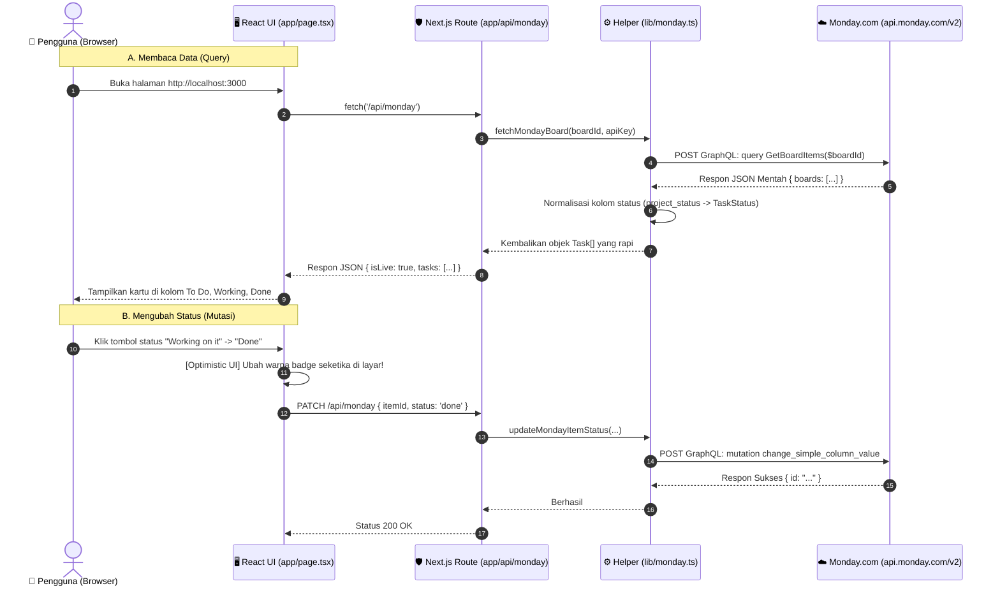

# 📘 PANDUAN LENGKAP: Memahami FlowBoard & Monday.com GraphQL API v2
> **Pedoman Belajar Ramah Pemula & Junior Developer**  
> Ditulis secara runtut: *Mengapa dibuat seperti ini? Apa fungsi baris ini? Bagaimana data mengalir dari klik tombol hingga ke server Monday.com?*

---

## 🎯 Daftar Isi
1. [Analogi Sederhana: Memahami Seluruh Sistem](#1-analogi-sederhana-memahami-seluruh-sistem)
2. [Peta Arsitektur & Alur Data (Data Flow Diagram)](#2-peta-arsitektur--alur-data-data-flow-diagram)
3. [Daftar File & Perannya (Kenapa File Ini Harus Ada?)](#3-daftar-file--perannya-kenapa-file-ini-harus-ada)
4. [Bedah Kode File per File: Kenapa Begitu? Apa Ini Apa Itu?](#4-bedah-kode-file-per-file-kenapa-begitu-apa-ini-apa-itu)
   - [A. lib/task.ts (Model Data & Normalisasi)](#a-libtaskts-model-data--normalisasi)
   - [B. lib/graphql.ts (Sintaks Query & Mutasi)](#b-libgraphqlts-sintaks-query--mutasi)
   - [C. lib/monday.ts (Mesin Komunikasi API)](#c-libmondayts-mesin-komunikasi-api)
   - [D. app/api/monday/route.ts (Satpam Backend & Jembatan CORS)](#d-appapimondayroutets-satpam-backend--jembatan-cors)
   - [E. app/page.tsx (Antarmuka React & Optimistic UI)](#e-apppagetsx-antarmuka-react--optimistic-ui)
5. [Pertanyaan Kritis yang Sering Ditanyakan Pemula (FAQ Junior)](#5-pertanyaan-kritis-yang-sering-ditanyakan-pemula-faq-junior)
6. [Kamus Istilah untuk Junior Developer](#6-kamus-istilah-untuk-junior-developer)
7. [Latihan Praktik Mandiri](#7-latihan-praktik-mandiri)

---

## 1. Analogi Sederhana: Memahami Seluruh Sistem

Bayangkan sistem ini seperti sebuah **Restoran Modern**:

1. **Monday.com Cloud**: Adalah **Gudang Pusat Bahan Makanan**. Tempat semua data resmi (board, task, status) disimpan permanen.
2. **Klien / Browser Anda (`app/page.tsx`)**: Adalah **Meja Tamu**. Tempat pengguna melihat menu, mengklik tombol, dan menikmati tampilan antarmuka (Kanban / List).
3. **Backend Next.js API Route (`app/api/monday/route.ts`)**: Adalah **Pelayan Restoran**. Tamu di meja tidak boleh langsung masuk ke gudang pusat demi alasan keamanan (*keamanan token* & *aturan CORS*). Tamu memesan ke pelayan, lalu pelayan yang pergi ke gudang.
4. **GraphQL (`lib/graphql.ts`)**: Adalah **Nota Pesanan Khusus**. Berbeda dengan REST API yang membawa satu paket makanan standar (sering kelebihan makanan), dengan GraphQL pelayan menulis: *"Saya hanya butuh 1 telur, nama task, dan statusnya saja"*. Gudang hanya mengirim yang diminta.
5. **File `.env.local`**: Adalah **Kunci Brankas Pelayan**. Menyimpan kartu akses (*Personal API Token*) agar pelayan diizinkan masuk ke gudang Monday.com.

---

## 2. Peta Arsitektur & Alur Data (Data Flow Diagram)

Berikut alur lengkap yang terjadi ketika Anda membuka web atau mengklik status task:



---

## 3. Daftar File & Perannya (Kenapa File Ini Harus Ada?)

| Nama File | Peran Utama | Jika File Ini Dihapus, Apa yang Terjadi? |
|---|---|---|
| **`.env.local`** | Menyimpan `MONDAY_API_KEY` dan `MONDAY_BOARD_ID` rahasia di komputer lokal Anda. | Aplikasi tidak bisa masuk ke akun Monday.com Anda dan akan berjalan di Mode Demo. |
| **`lib/task.ts`** | Mendefinisikan bentuk data task TypeScript dan fungsi penerjemah label status. | TypeScript error karena aplikasi tidak tahu apa itu `Task`, `TaskStatus`, atau warna badge apa yang dipakai. |
| **`lib/graphql.ts`** | Buku kamus yang berisi teks query dan mutasi GraphQL standar Monday.com. | Koding GraphQL berserakan di mana-mana dan sulit dirawat atau diuji di GraphQL Explorer. |
| **`lib/monday.ts`** | Fungsi logika yang membungkus `fetch` ke server Monday.com dan menangani error. | Backend API Route harus menulis ulang logika HTTP fetch yang panjang berkali-kali. |
| **`app/api/monday/route.ts`** | Backend server mini di Next.js untuk mencegah masalah CORS browser dan melindungi API key. | Browser akan menolak panggilan API ke Monday.com karena aturan keamanan *Cross-Origin Resource Sharing (CORS)*. |
| **`app/page.tsx`** | Tampilan visual interaktif (Kanban Board, List View, Add Task, dan GraphQL Explorer). | Pengguna hanya melihat layar kosong karena tidak ada halaman depan. |
| **`app/globals.css`** | Konfigurasi CSS Tailwind dan variabel warna khas Monday.com. | Tampilan web akan menjadi teks polos tanpa warna, tata letak, atau tombol yang indah. |

---

## 4. Bedah Kode File per File: Kenapa Begitu? Apa Ini Apa Itu?

Mari kita bedah setiap file dengan kacamata orang yang baru belajar koding.

---

### A. `lib/task.ts` (Model Data & Normalisasi)

#### 1. Mengapa Menggunakan `type` dan `interface`?
```typescript
export type TaskStatus = 'todo' | 'working' | 'done';
export type TaskPriority = 'low' | 'medium' | 'high';

export interface Task {
  id: string | number;
  title: string;
  status: TaskStatus;
  priority?: TaskPriority; // Tanda tanya (?) berarti opsional (boleh kosong)
  assignedTo?: string;
  mondayId?: string;
  createdAt?: string;
}
```
* **Kenapa tidak pakai `any`?**  
  Jika kita memakai `any`, saat salah mengetik (misal `task.ststus`), editor tidak akan memberi tahu. Dengan `Task`, editor (VS Code) langsung memberi garis merah jika ada salah ketik.
* **Kenapa `TaskStatus` dibatasi 3 nilai saja?**  
  Agar alur sistem pasti dan terprediksi: task hanya boleh berada di salah satu dari 3 kolom Kanban: *To Do*, *Working on it*, atau *Done*.

#### 2. Fungsi Normalisasi: Mengapa Ini Sangat Penting?
```typescript
export function normalizeMondayStatus(label?: string | null): TaskStatus {
  if (!label) return 'todo';
  const clean = label.toLowerCase().trim();
  if (clean.includes('done') || clean.includes('selesai')) return 'done';
  if (clean.includes('work') || clean.includes('progress') || clean.includes('sedang')) return 'working';
  return 'todo';
}
```
* **Masalah di Dunia Nyata:**  
  Di Monday.com, setiap orang bisa menamai status sesuka hati: ada yang menulis *"Done"*, ada yang menulis *"done"*, ada yang menulis *"Selesai"*, bahkan *"In Progress"*.
* **Solusi Fungsi Ini:**  
  Fungsi ini bertindak seperti penerjemah pintar: apa pun variasinya, aplikasi kita secara seragam memahaminya sebagai salah satu dari `'todo'`, `'working'`, atau `'done'`.

---

### B. `lib/graphql.ts` (Sintaks Query & Mutasi)

File ini berisi teks GraphQL murni. Mari kita pahami sintaksnya:

#### 1. Membaca Item Board (Query)
```graphql
query GetBoardItems($boardId: [ID!]) {
  boards(ids: $boardId) {
    id
    name
    columns {
      id
      title
      type
    }
    items_page(limit: 50) {
      items {
        id
        name
        column_values {
          id
          type
          text
          value
        }
      }
    }
  }
}
```

* **Kenapa ada kata `query` di depan?**  
  Memberi tahu GraphQL server: *"Saya hanya ingin membaca data, tidak ada data yang diubah."*
* **Apa maksud `$boardId: [ID!]`?**  
  - Tanda `$` menandakan sebuah **variabel dinamis**. Nilainya tidak ditulis mati (*hardcode*) di dalam query, melainkan dikirimkan terpisah di objek `variables`.
  - Tanda kurung siku `[...]` berarti bernilai **Array / List**.
  - Tanda seru `!` berarti **Wajib diisi (Required / Non-nullable)**.
* **Kenapa kita meminta `columns` dan `items_page` sekaligus?**  
  Inilah keunggulan utama GraphQL! Dalam **satu kali kirim**, kita langsung mendapatkan:
  1. Nama Board
  2. Daftar kolom yang ada di board
  3. 50 task pertama beserta isi nilai kolomnya!

#### 2. Mengubah Status Task (Mutation)
```graphql
mutation UpdateTaskStatus($boardId: ID!, $itemId: ID!, $columnId: String!, $value: String!) {
  change_simple_column_value(
    board_id: $boardId,
    item_id: $itemId,
    column_id: $columnId,
    value: $value
  ) {
    id
  }
}
```
* **Kenapa menggunakan kata `mutation`?**  
  Di GraphQL, semua operasi yang **menambah, mengedit, atau menghapus** data WAJIB diawali dengan kata `mutation`.
* **Mengapa memakai `change_simple_column_value`?**  
  Monday.com menyediakan dua cara ubah kolom:
  1. `change_column_value` (memerlukan payload string JSON rumit `{\"index\": 0}`).
  2. `change_simple_column_value` (cukup kirim string sederhana seperti `"Done"` atau `"Working on it"`). Cara kedua jauh lebih mudah dipahami dan minim bug!

---

### C. `lib/monday.ts` (Mesin Komunikasi API)

File ini adalah jantung yang melakukan pengiriman data ke internet.

#### 1. Fungsi Utama: `executeMondayGraphQL`
```typescript
export async function executeMondayGraphQL<T = unknown>(
  query: string,
  variables: Record<string, unknown> = {},
  apiKey?: string
): Promise<T> {
  // 1. Ambil token dari parameter atau dari .env.local
  const token = apiKey || process.env.MONDAY_API_KEY;

  if (!token) {
    throw new Error('API Key Monday.com belum disetel.');
  }

  // 2. Kirim permintaan HTTP POST ke endpoint resmi Monday
  const response = await fetch('https://api.monday.com/v2', {
    method: 'POST',
    headers: {
      'Content-Type': 'application/json',
      Authorization: token,
      'API-Version': '2024-01', // Selalu kunci versi API agar tidak kena breaking changes
    },
    body: JSON.stringify({ query, variables }),
  });

  // 3. Tangkap respon JSON
  const result = await response.json();

  // 4. Deteksi error bawaan GraphQL
  if (result.errors && result.errors.length > 0) {
    const errorMessage = result.errors.map((e: any) => e.message).join(', ');
    throw new Error(`Monday.com GraphQL Error: ${errorMessage}`);
  }

  return result.data as T;
}
```

* **Kenapa header `'API-Version': '2024-01'` harus disertakan?**  
  Monday.com memperbarui API secara berkala. Menentukan versi menjamin query kita tidak akan mendadak rusak saat Monday.com merilis fitur baru di masa depan.
* **Kenapa harus mengecek `result.errors`?**  
  Pada GraphQL, meskipun query salah (misal ID board tidak ditemukan), server tetap mengembalikan status HTTP `200 OK`. Namun di dalam body JSON ada properti `errors: [...]`. Kode di atas mendeteksi ini dan melempar pesan error yang ramah.

#### 2. Deteksi Kolom Dinamis: Mengapa Tidak Hardcode `status`?
Perhatikan baris kode pada fungsi `fetchMondayBoard`:
```typescript
const statusColumn = board.columns.find(
  (col) => col.type === 'status' || col.id === 'status' || col.title.toLowerCase().includes('status')
);
```
* **Kenyataan di Lapangan:**  
  Pada akun Monday.com Anda, kolom status bernama **`project_status`**, bukan `status`!  
  Jika programmer pemula melakukan *hardcode* `column_id = "status"`, aplikasinya akan langsung error dan task tidak akan muncul.  
  Dengan mencari `col.type === 'status'`, kode kita **100% fleksibel** dan bisa bekerja di board milik siapa saja!

---

### D. `app/api/monday/route.ts` (Satpam Backend & Jembatan CORS)

File ini berjalan di server Next.js (Node.js runtime).

#### 1. Mengapa Browser Butuh File Ini?
Jika kode React di browser langsung memanggil `fetch('https://api.monday.com/v2')`:
1. **Bahaya Keamanan Fatal**: Siapa pun bisa menekan tombol `F12` (Inspect Element) > tab Network, lalu melihat token rahasia Anda. Dengan token itu, orang lain bisa membaca atau menghapus seluruh proyek di Monday.com Anda!
2. **Diblokir CORS**: Browser modern memiliki aturan keamanan ketat bernama **CORS (Cross-Origin Resource Sharing)** yang melarang JavaScript browser memanggil API domain lain tanpa izin server.

Dengan meletakkan panggilan di `app/api/monday/route.ts`:
* Browser hanya berbicara dengan server lokalnya sendiri (`/api/monday`).
* Server Next.js yang memanggil Monday.com secara aman di latar belakang. Kunci API Anda tetap aman 100%!

---

### E. `app/page.tsx` (Antarmuka React & Optimistic UI)

File ini mengatur apa yang Anda lihat di layar monitor.

#### 1. Mengapa Ada Baris `'use client'` di Paling Atas?
```typescript
'use client';
```
Di Next.js (App Router), semua file secara default adalah **Server Component** (dibuat di server, tidak bisa ada klik tombol atau form input).  
Menulis `'use client'` memberitahu Next.js: *"File ini adalah Client Component yang membutuhkan interaktivitas pengguna (klik tombol, form input, state, useEffect)."*

#### 2. Apa itu `useState`?
```typescript
const [tasks, setTasks] = useState<Task[]>([]);
```
* **Kenapa tidak pakai variabel biasa seperti `let tasks = []`?**  
  Dalam React, jika Anda mengubah variabel biasa `tasks.push(newTask)`, React **tidak tahu** bahwa ada data baru, sehingga tampilan layar tidak akan diperbarui (*re-render*).  
  Dengan `setTasks(...)`, React langsung menyadari ada perubahan data dan menggambar ulang layar seketika!

#### 3. Apa itu *Optimistic UI Update*?
Perhatikan fungsi saat Anda mengklik status task:
```typescript
// 1. Langsung ubah status di state layar seketika! (Pengguna tidak perlu menunggu)
setTasks((prev) =>
  prev.map((t) => (t.id === task.id ? { ...t, status: nextStatus } : t))
);

// 2. Kirim update ke server di latar belakang
const res = await fetch('/api/monday', { method: 'PATCH', ... });

// 3. Jika internet putus atau server gagal, kembalikan status ke semula (Rollback)
if (!res.ok) {
  setTasks((prev) =>
    prev.map((t) => (t.id === task.id ? { ...t, status: task.status } : t))
  );
}
```
* **Kenapa disebut Optimistic?**  
  Karena kita "optimis" bahwa koneksi internet pasti berhasil. Pengguna merasa aplikasinya **secepat kilat** tanpa jeda loading berputar-putar. Namun jika gagal, sistem secara pintar mengembalikan posisinya (*rollback*).

---

## 5. Pertanyaan Kritis yang Sering Ditanyakan Pemula (FAQ Junior)

### Q1: Apa bedanya file `.env` dan `.env.local`?
* `.env`: Berisi nilai default yang biasanya di-commit ke Git (tanpa kunci rahasia).
* `.env.local`: Khusus untuk komputer lokal Anda. Berisi kunci rahasia sungguhan dan **TIDAK PERNAH** boleh di-push ke GitHub publik.

### Q2: Mengapa di GraphQL tidak ada error 404 saat data kosong?
GraphQL menganggap *"data tidak ada"* adalah sebuah respon yang valid. Server tetap menjawab HTTP `200 OK`, namun isi objeknya adalah `{ data: { boards: [] } }` (array kosong).

### Q3: Mengapa kartu task saya sebelumnya tidak ada padding atau terlihat aneh?
Karena pada Tailwind CSS v4, variabel font Geist harus dihubungkan dengan benar di `globals.css` (`--font-sans: var(--font-geist-sans)`), dan komponen Card harus memiliki padding jelas (`p-5 sm:p-6`) bukan bergantung pada formula kalkulasi `--card-spacing` yang belum didefinisikan.

---

## 6. Kamus Istilah untuk Junior Developer

| Istilah | Penjelasan Sederhana |
|---|---|
| **GraphQL** | Bahasa permintaan data di mana klien meminta persis field data yang diinginkan dari server. |
| **Query** | Operasi GraphQL untuk **membaca / mengambil** data tanpa mengubah data di server. |
| **Mutation** | Operasi GraphQL untuk **menulis, mengedit, atau menghapus** data di server. |
| **Payload** | Data inti yang dikirimkan atau diterima dalam sebuah transaksi HTTP. |
| **CORS** | Sistem keamanan browser yang mencegah website asing membaca data dari server tanpa izin. |
| **Optimistic UI** | Teknik UI di mana layar langsung berubah seketika sebelum respon server selesai diterima. |
| **Type Safety** | Perlindungan kode oleh TypeScript agar tidak terjadi salah ketik nama variabel atau fungsi. |
| **Bearer Token** | Tiket otentikasi digital yang membuktikan bahwa pemegang tiket memiliki izin akses resmi. |

---

## 7. Latihan Praktik Mandiri

Untuk menguji pemahaman Anda, cobalah lakukan 2 tantangan kecil ini:

### 🎯 Tantangan 1: Coba Buat Task Lewat GraphQL Explorer
1. Buka browser di **[http://localhost:3000](http://localhost:3000)**.
2. Klik tombol **GraphQL Explorer** di navbar atas.
3. Pilih preset **`4. Buat Task Baru (create_item)`**.
4. Ubah nama task menjadi: `"Task Belajar Mandiri"`.
5. Klik tombol hijau **"Jalankan Query"**.
6. Refresh papan FlowBoard atau akun Monday.com Anda. Task baru Anda akan langsung muncul!

### 🎯 Tantangan 2: Eksplorasi Profil User
Pilih preset **`1. Cek Profil Akun (me)`** di GraphQL Explorer, tambahkan field `is_guest` atau `account { id name }`:
```graphql
query {
  me {
    id
    name
    email
    account {
      id
      name
    }
  }
}
```
Klik **Jalankan Query** dan amati bagaimana GraphQL mengembalikan informasi akun workspace Monday.com Anda!

---

*Selamat belajar! Sekarang Anda tidak hanya bisa menjalankan kodenya, tetapi juga paham mengapa setiap baris kode ditulis.* 🚀
